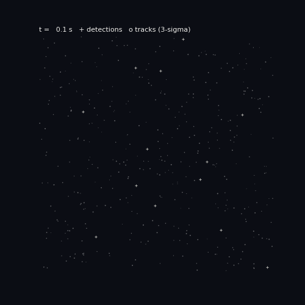
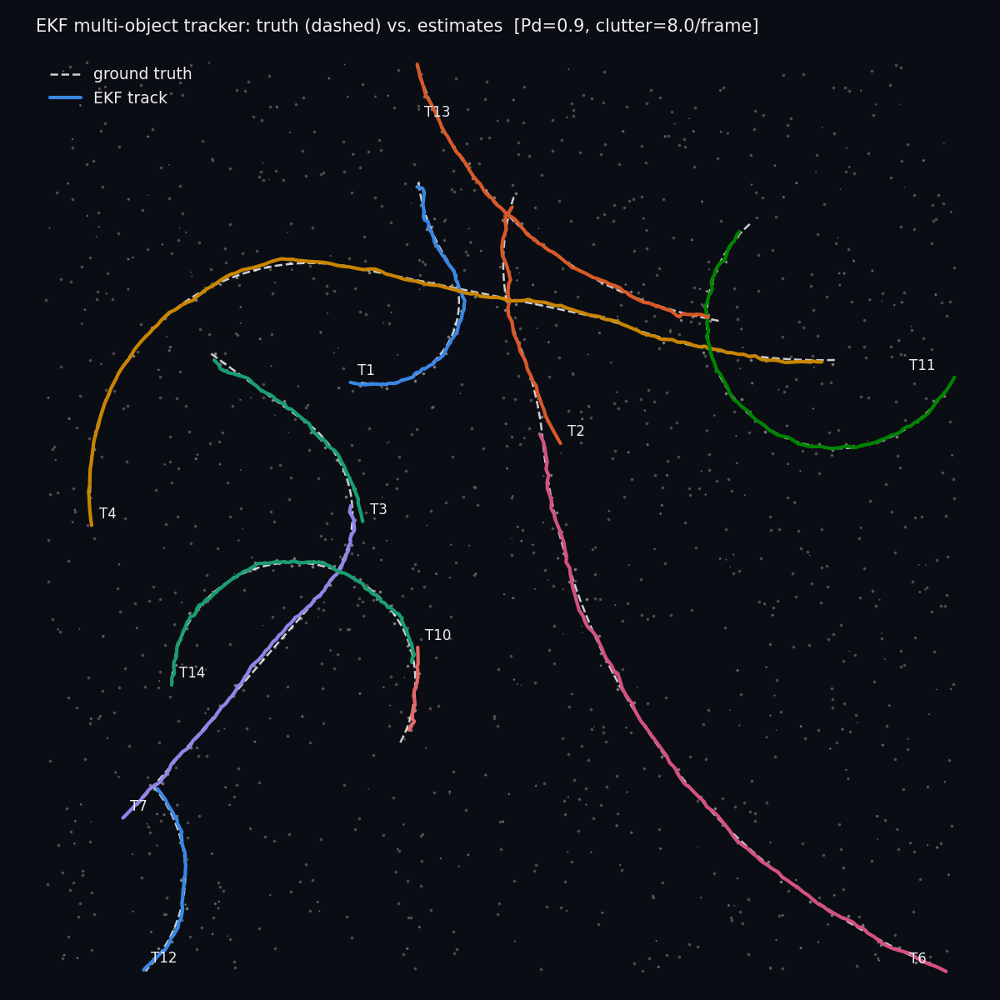
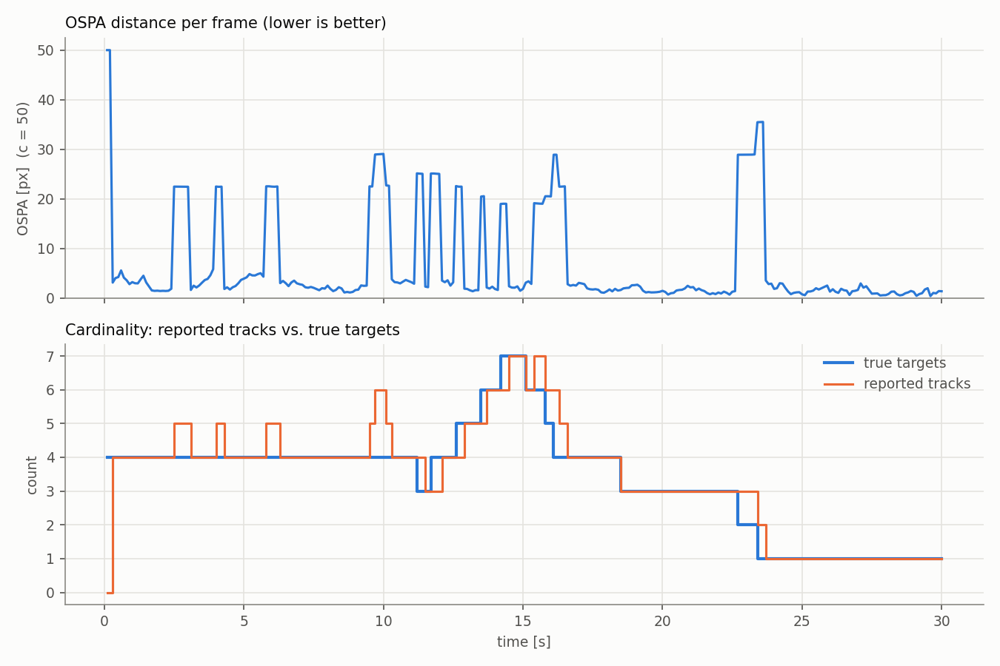
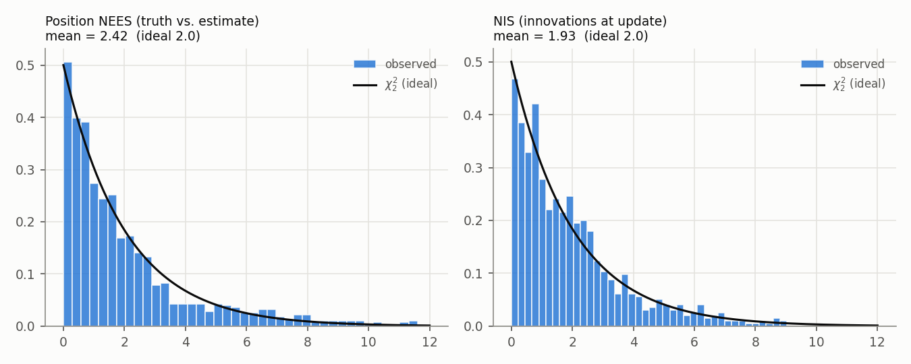

# ekf-mot: Extended Kalman Filter Multi-Object Tracker



A from-scratch multi-object tracker for maneuvering targets in a cluttered 2D star-field scene. Each target gets an **Extended Kalman Filter** with a nonlinear **coordinated-turn** motion model; detections are assigned to tracks with **chi-square gating** and the **Hungarian algorithm**; tracks move through a **tentative → confirmed → lost** lifecycle. Evaluated with CLEAR-MOT (MOTA/MOTP), OSPA, and filter-consistency tests (NEES/NIS), with a Monte Carlo sweep and two ablations.

**Headline (default scenario: 8 maneuvering targets, Pd = 0.9, ~8 false alarms/frame):**
MOTA **0.92**, position RMSE **2.5 px** against 3 px/axis detector noise (**42% lower** than raw detections, whose RMS error is 4.2 px), 3 ID switches in 300 frames, mean NEES **2.4** (ideal 2.0). Across a 5-seed sweep the CT-EKF cuts position RMSE **10–15%** versus a tuned constant-velocity Kalman filter.

> Numbers above come from the seeded runs in this repo. Re-run `scripts/run_sim.py` and `scripts/sweep.py` to reproduce them.

---

## How it works

Every frame runs four steps (`mot/tracker.py`):

1. **Predict:** propagate each track's EKF with the coordinated-turn model.
2. **Associate:** Mahalanobis gate (χ² at 99%), then a globally optimal one-to-one assignment with `scipy.optimize.linear_sum_assignment`.
3. **Update:** EKF measurement update (Joseph-form covariance) for matched tracks.
4. **Manage:** unmatched detections start tentative tracks; 3 hits confirm; misses make a track *lost* (coasting); 6 misses, a blown-up covariance, or leaving the field of view delete it.

### Motion model (`mot/models.py`)

State `x = [px, py, vx, vy, ω]`. With `T = dt`:

```
px' = px + (sin ωT / ω) vx − ((1 − cos ωT) / ω) vy
py' = py + ((1 − cos ωT) / ω) vx + (sin ωT / ω) vy
vx' = cos ωT · vx − sin ωT · vy
vy' = sin ωT · vx + cos ωT · vy
ω'  = ω
```

The dynamics are nonlinear in ω, so the filter linearizes with the analytic Jacobian `F = ∂f/∂x`. For |ω| < 10⁻³ a Taylor series replaces the closed form, avoiding 0/0 and the catastrophic cancellation in `1 − cos ωT` (a real bug that the finite-difference Jacobian test caught during development).

### EKF (`mot/ekf.py`)

```
Predict:  x ← f(x)                 P ← F P Fᵀ + Q
Update:   y = z − h(x)             S = H P Hᵀ + R
          K = P Hᵀ S⁻¹             x ← x + K y
          P ← (I − KH) P (I − KH)ᵀ + K R Kᵀ
```

### Sensors

| Sensor | `h(x)` | Linear? | Use |
|---|---|---|---|
| `cartesian` (default) | `[px, py]` | yes | camera pixel detections |
| `range_bearing` | `[‖p − s‖, atan2]` from sensor at scene center | no (bearing wrapped to [−π, π)) | radar-style sensor |

### Association cost

`cost = d² + ln|S|` inside the gate, infeasible outside. The `ln|S|` term (from the Gaussian likelihood) keeps a vague new track from stealing a detection from a sharp confirmed one.

---

## Results

### Single run (`python scripts/run_sim.py`)

| Metric | Cartesian sensor | Range-bearing sensor |
|---|---|---|
| MOTA | 0.924 | 0.921 |
| Recall | 0.980 | 0.980 |
| Position RMSE | 2.48 px | 1.88 px |
| MOTP (mean matched distance) | 2.05 px | 1.55 px |
| ID switches | 3 | 5 |
| False-track frames | 53 | 54 |
| Mean OSPA (c = 50) | 6.75 px | 6.50 px |
| Mean position NEES (ideal 2.0) | 2.42 | 1.84 |
| Mean NIS (ideal 2.0) | 1.93 | 1.91 |





Each OSPA spike lines up with a cardinality error: a short-lived false track confirmed from clutter, or the 2-frame delay before a newly appeared target is confirmed.



NEES and NIS histograms track the χ²₂ density, so the filter's reported covariance matches its actual error: it is neither overconfident nor overly cautious.

### Monte Carlo sweep and ablations (`python scripts/sweep.py`)

Mean over 5 seeds, 300 frames at 10 Hz, 3 px measurement noise. The CV-KF baseline is the same code with turn rate frozen at 0 and process noise tuned up (σₐ = 20) so it can follow turns.

| Targets | Pd | Clutter/frame | Variant | MOTA | Pos RMSE [px] | ID sw. | False-track frames | Mean OSPA [px] | Mean NEES |
|---|---|---|---|---|---|---|---|---|---|
| 10 | 0.95 | 2 | **CT-EKF + Hungarian** | 0.961 | **2.16** | 3.6 | 27.8 | 4.87 | 2.00 |
| 10 | 0.95 | 2 | CV-KF + Hungarian | 0.960 | 2.48 | 4.6 | 25.8 | 5.03 | 1.94 |
| 10 | 0.95 | 2 | CT-EKF + greedy | 0.963 | 2.16 | 3.0 | 26.2 | 4.79 | 2.00 |
| 10 | 0.90 | 10 | **CT-EKF + Hungarian** | 0.951 | **2.27** | 3.4 | 39.6 | 5.54 | 1.91 |
| 10 | 0.90 | 10 | CV-KF + Hungarian | 0.947 | 2.59 | 4.6 | 42.6 | 6.09 | 1.86 |
| 10 | 0.90 | 10 | CT-EKF + greedy | 0.951 | 2.27 | 3.4 | 39.6 | 5.54 | 1.91 |
| 10 | 0.90 | 25 | **CT-EKF + Hungarian** | 0.798 | **2.34** | 8.4 | 249.4 | 16.03 | 2.11 |
| 10 | 0.90 | 25 | CV-KF + Hungarian | 0.811 | 2.59 | 6.0 | 233.2 | 15.50 | 1.95 |
| 10 | 0.90 | 25 | CT-EKF + greedy | 0.794 | 2.36 | 9.4 | 254.2 | 16.13 | 2.13 |
| 10 | 0.70 | 10 | **CT-EKF + Hungarian** | 0.941 | **2.53** | 3.2 | 38.0 | 6.92 | 1.96 |
| 10 | 0.70 | 10 | CV-KF + Hungarian | 0.939 | 2.99 | 4.2 | 36.0 | 7.32 | 1.97 |
| 10 | 0.70 | 10 | CT-EKF + greedy | 0.940 | 2.53 | 4.0 | 38.0 | 6.92 | 1.96 |
| 30 | 0.90 | 10 | **CT-EKF + Hungarian** | 0.954 | **2.26** | 10.2 | 104.2 | 7.18 | 2.02 |
| 30 | 0.90 | 10 | CV-KF + Hungarian | 0.951 | 2.61 | 14.0 | 111.0 | 7.52 | 1.95 |
| 30 | 0.90 | 10 | CT-EKF + greedy | 0.954 | 2.27 | 11.0 | 105.6 | 7.23 | 2.03 |

### Discussion

- **The nonlinear motion model pays off in accuracy.** The CT-EKF lowers position RMSE 10–15% versus the constant-velocity filter in every scenario, and has fewer ID switches in 4 of 5. A CV filter can only follow a turn by inflating its process noise, which also lets more measurement noise through.
- **Consistency holds across conditions.** Mean NEES stays within 1.9–2.1 of the ideal 2.0, so the covariance can be trusted downstream, for gating here and for any planner or controller that consumes the tracks.
- **Heavy clutter is the weak point.** At 25 false alarms/frame, MOTA drops to about 0.80, driven almost entirely by false tracks: 3 consecutive gated clutter hits are no longer rare. Stronger confirmation logic (M-of-N, a minimum-speed test, or track scoring with a log-likelihood ratio) is the next fix.
- **Hungarian vs. greedy is a near-tie at these densities.** With tight gates, conflicting assignments are uncommon, so both find the same answer most frames; the difference shows up only as slightly fewer ID switches and false tracks in the hardest cases. The unit test `test_hungarian_beats_greedy` shows the configuration where greedy fails outright.

---

## Quickstart

```bash
python3 -m venv .venv && source .venv/bin/activate     # Windows: .venv\Scripts\Activate.ps1
pip install -r requirements.txt
pytest -q                                               # 18 tests
python scripts/run_sim.py --animate                     # plots + GIF in results/
python scripts/run_sim.py --sensor range_bearing        # radar-style sensor
python scripts/run_sim.py --clutter 20 --pd 0.8 --seed 3
python scripts/sweep.py --seeds 5                       # ~3 min, writes results/sweep.md
```

## Repository layout

```
ekf-mot/
├── mot/
│   ├── models.py        # coordinated-turn motion model; cartesian + range-bearing sensors
│   ├── ekf.py           # EKF predict / update (Joseph form)
│   ├── association.py   # chi-square gating, Hungarian + greedy assignment
│   ├── tracker.py       # track lifecycle (tentative / confirmed / lost)
│   ├── sim.py           # star-field scenario: births, deaths, maneuvers, misses, clutter
│   ├── metrics.py       # MOTA, MOTP, ID switches, OSPA, NEES
│   └── viz.py           # plots and GIF
├── scripts/
│   ├── run_sim.py       # one scenario -> plots + summary.json
│   └── sweep.py         # Monte Carlo sweep + ablations -> sweep.md
├── tests/
│   ├── test_models.py   # Jacobians vs. finite differences, angle wrapping
│   └── test_tracker.py  # association, lifecycle, OSPA, end-to-end
└── results/
```

## Tests

- Every analytic Jacobian (`F`, both `H`s) is checked against central finite differences, including turn rates on both sides of the Taylor-series switch.
- Hungarian vs. greedy on a configuration where greedy fails.
- Track lifecycle: confirm after 3 hits, coast on misses, delete after `max_coast`.
- End to end: a clean scene must reach recall > 0.95 and RMSE below the raw measurement noise with zero ID switches.

## Roadmap

- [x] Level 1: simulated EKF tracker, metrics, ablations
- [ ] Level 2: real webcam / phone video with OpenCV detections through the same `Tracker.step()` interface
- [ ] Level 3: Raspberry Pi pan-tilt camera that follows a confirmed track
- [ ] IMM (straight + turning models), JPDA for dense clutter, UKF comparison

## References

- Y. Bar-Shalom, X. R. Li, T. Kirubarajan, *Estimation with Applications to Tracking and Navigation*, Wiley, 2001 (coordinated-turn model, NEES/NIS).
- K. Bernardin, R. Stiefelhagen, "Evaluating Multiple Object Tracking Performance: The CLEAR MOT Metrics," *EURASIP JIVP*, 2008.
- D. Schuhmacher, B.-T. Vo, B.-N. Vo, "A Consistent Metric for Performance Evaluation of Multi-Object Filters," *IEEE TSP*, 2008 (OSPA).
- H. W. Kuhn, "The Hungarian Method for the Assignment Problem," 1955.
